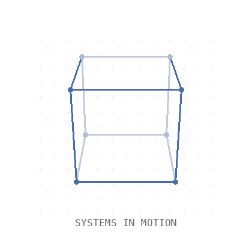
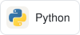
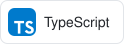
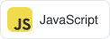
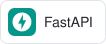
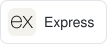
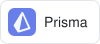
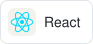
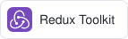

<picture>
  <source media="(prefers-reduced-motion: reduce)" srcset="./assets/header.png">
  
</picture>

### Backend & AI Engineer · Full-Stack Developer

I build AI-powered applications and the backend systems behind them. Studying **Artificial Intelligence at Newton School of Technology, Rishihood University** (2024–2028), with a focus on generative AI, agentic workflows, and full-stack development.

---

### 01 / Contact

<table>
  <tr>
    <td align="center" valign="middle">
      <!-- Replace this picture block with your photo whenever you're ready. -->
      <picture>
        <source media="(prefers-reduced-motion: reduce)" srcset="./assets/profile.png">
        
      </picture>
    </td>
    <td valign="middle">
      <strong>Anant Jain</strong> 
      Backend · AI · Full Stack  
      <samp>Website .... </samp><!-- Website URL: --> 
      <samp>GitHub ..... </samp><a href="https://github.com/anantjain-afk">@anantjain-afk</a> 
      <samp>LinkedIn ... </samp><a href="https://www.linkedin.com/in/anant-jain-342a95322/">Anant Jain ↗</a> 
      <samp>Email ...... </samp><a href="mailto:anant.jain2024@nst.rishihood.edu.in">Write to me ↗</a> 
      <samp>LeetCode ... </samp><a href="https://leetcode.com/u/anantjain47/">anantjain47</a> 
      <samp>Twitter / X </samp><!-- Twitter / X URL: -->
    </td>
  </tr>
</table>

### 02 / Selected work

- **[ResearchAIAgent](https://github.com/anantjain-afk/ResearchAIAgent)**
- **[LookingForGroup](https://github.com/anantjain-afk/LookingForGroup)** — A real-time app connecting gamers through live lobbies, text chat, and peer-to-peer voice. [Live ↗](https://looking-for-group.vercel.app/)

### 03 / Toolkit

LANGUAGES

  
  
  
  

BACKEND & DATA

  
  
  
  
  
  

AI & AGENTS

  
  
   Machine learning · NLP · Generative AI

FRONTEND

  
  
  
  
  
  

TOOLS

  
  

### 04 / Experience

**Alphavima Technologies** · Full-Stack Developer Intern  
Built employee portal modules and collaborated on API integration and testing.

**Get Interview Confidence** · Frontend Developer Intern  
Built responsive interfaces with Next.js and Tailwind CSS.

---

Interested in backend systems, AI agents, and thoughtful web experiences? <a href="https://www.linkedin.com/in/anant-jain-342a95322/">Let’s connect ↗</a>
