<picture>
  <source media="(prefers-reduced-motion: reduce)" srcset="./assets/header.png">
  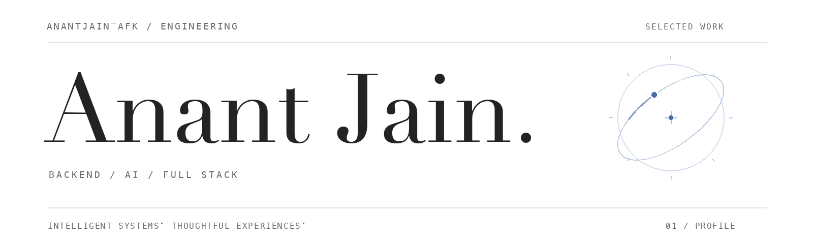
</picture>

<picture>
  <source media="(max-width: 600px)" srcset="./assets/tagline-mobile.png">
  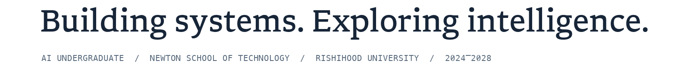
</picture>

<!-- Full-width contact panel. Contact values and the animated illustration can be edited in scripts/generate_assets.py. Website and Twitter / X are intentionally blank. -->
<picture>
  <source media="(prefers-reduced-motion: reduce) and (max-width: 600px)" srcset="./assets/contact-mobile.png">
  <source media="(max-width: 600px)" srcset="./assets/contact-mobile.gif">
  <source media="(prefers-reduced-motion: reduce)" srcset="./assets/contact.png">
  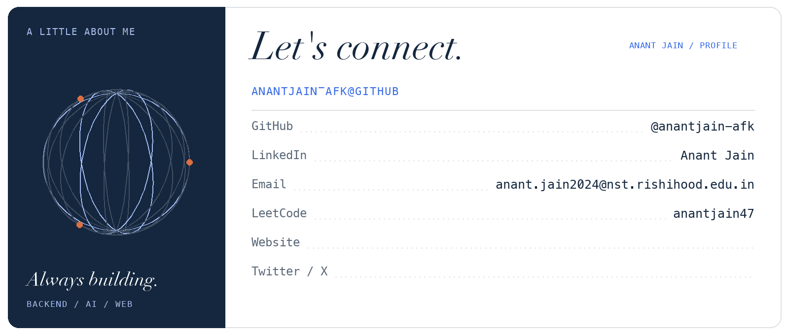
</picture>

  <a href="https://github.com/anantjain-afk">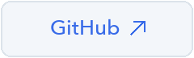</a>
  <a href="https://www.linkedin.com/in/anant-jain-342a95322/">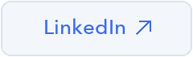</a>
  <a href="mailto:anant.jain2024@nst.rishihood.edu.in">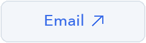</a>
  <a href="https://leetcode.com/u/anantjain47/">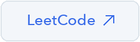</a>

<!-- Website URL: -->
<!-- Twitter / X URL: -->

<picture>
  <source media="(max-width: 600px)" srcset="./assets/work-heading-mobile.png">
  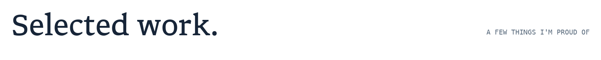
</picture>

<a href="https://github.com/anantjain-afk/ResearchAIAgent">
  <picture>
    <source media="(max-width: 600px)" srcset="./assets/project-research-mobile.png">
    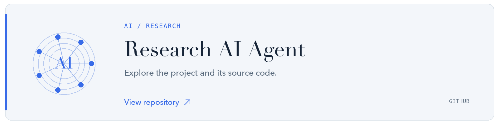
  </picture>
</a>

<a href="https://github.com/anantjain-afk/LookingForGroup">
  <picture>
    <source media="(max-width: 600px)" srcset="./assets/project-lfg-mobile.png">
    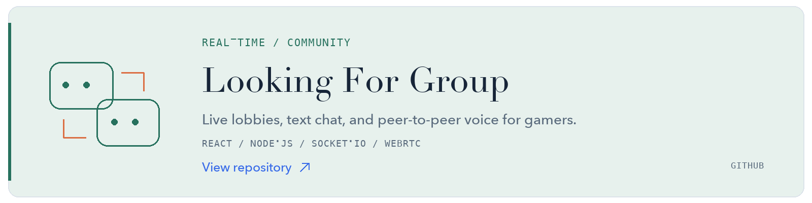
  </picture>
</a>

  

<picture>
  <source media="(max-width: 600px)" srcset="./assets/toolkit-heading-mobile.png">
  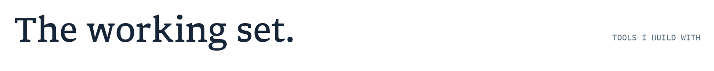
</picture>

<picture>
  <source media="(max-width: 600px)" srcset="./assets/toolkit-mobile.png">
  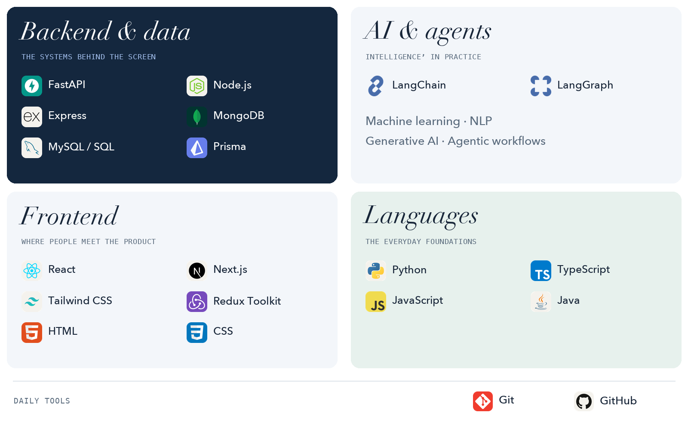
</picture>

<picture>
  <source media="(max-width: 600px)" srcset="./assets/experience-mobile.png">
  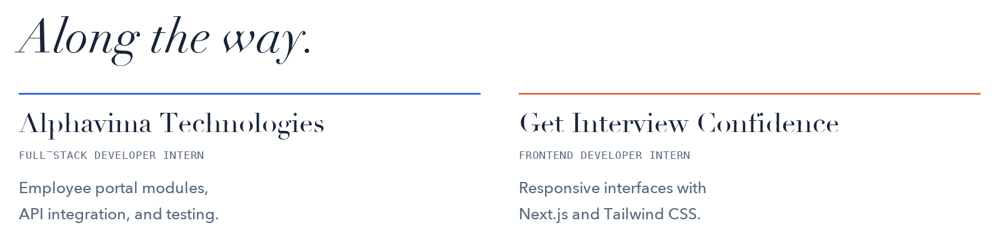
</picture>

<a href="https://www.linkedin.com/in/anant-jain-342a95322/">
  <picture>
    <source media="(max-width: 600px)" srcset="./assets/footer-mobile.png">
    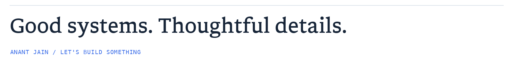
  </picture>
</a>

Text version & links

**Anant Jain — Backend & AI Engineer · Full-Stack Developer**

I build AI-powered applications and the backend systems behind them. Studying Artificial Intelligence at Newton School of Technology, Rishihood University (2024–2028).

**Selected work:** [ResearchAIAgent](https://github.com/anantjain-afk/ResearchAIAgent) · [LookingForGroup](https://github.com/anantjain-afk/LookingForGroup) ([live demo](https://looking-for-group.vercel.app/)).

**Backend & data:** FastAPI, Node.js, Express, MongoDB, MySQL, SQL, Prisma.  
**AI:** LangChain, LangGraph, machine learning, NLP, generative AI, agentic workflows.  
**Frontend:** React, Next.js, Tailwind CSS, Redux Toolkit, HTML, CSS.  
**Languages & tools:** Python, TypeScript, JavaScript, Java, Git, GitHub.

**Experience:** Full-Stack Developer Intern at Alphavima Technologies; Frontend Developer Intern at Get Interview Confidence.

**Contact:** [GitHub](https://github.com/anantjain-afk) · [LinkedIn](https://www.linkedin.com/in/anant-jain-342a95322/) · [Email](mailto:anant.jain2024@nst.rishihood.edu.in) · [LeetCode](https://leetcode.com/u/anantjain47/).

